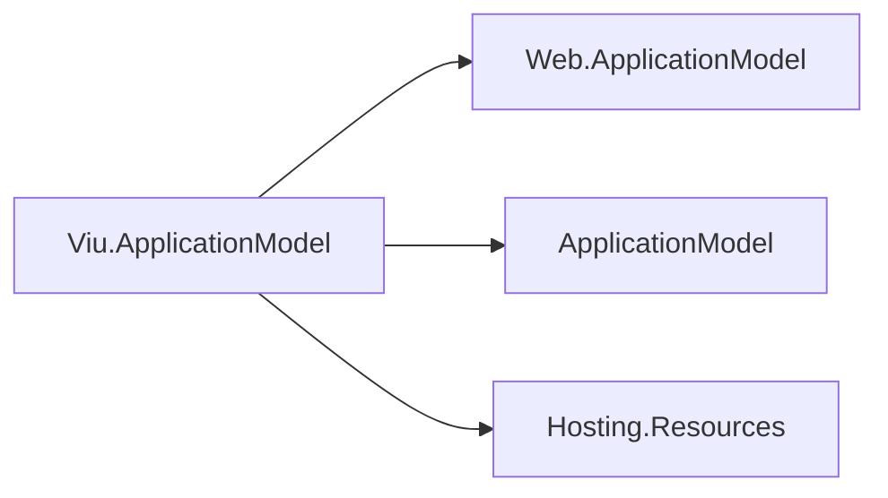

# Viu Web application model design

## Purpose and family map

This package adds apphost-side metadata validation and a typed descriptor over the existing Web
resource. It cannot host or render Viu. The dependency arrows point toward consumed packages:

| Package | Role |
| --- | --- |
| Assimalign.Cohesion.Viu.ApplicationModel | Viu manifest validation and descriptor wrapping |
| Assimalign.Cohesion.Web.ApplicationModel | Web resource, planner, commands and remote binding |
| Assimalign.Cohesion.ApplicationModel | Manifest, graph, descriptor and options contracts |
| Assimalign.Cohesion.Hosting.Resources | Resource control-plane contracts in the apphost boundary |

## Composition and planning

`WebResourceOptions` is sealed. `ViuWebResourceOptions` therefore derives from `ResourceOptions`
and creates Web options containing its replica and storage overrides. Forwarding the inherited
storage setting preserves Web's rejection of stateful storage rather than silently discarding it.
`ValidateClient` is consumed only at composition time. Missing and malformed properties produce
an exception naming the property and the `ViuClientReference` build input.

`AddViuWeb` calls `AddWeb` once and wraps its descriptor. The wrapper forwards resource identity,
plan, commands and dependencies, retaining its typed return from `DependsOn`. It snapshots the
three Viu strings/flags from the manifest; it introduces no new planner, workload or control plane.
Tests compare every serialized plan produced by complete Viu and Web application builds.
`RemoteReferenceViuWeb` validates an embedded manifest then delegates binding to `RemoteReferenceWeb`.

## Operational constraints and follow-up

`ValidateClient=false` permits legacy manifests; absent properties appear as empty strings and
false. It does not skip the Web kind check or Web planner validation. Manifest metadata describes
the default Server configuration (`true`, `/`); applications changing those runtime settings must
keep their manifest facts consistent.

Generated gateways select verbs by the manifest's `applicationModel` using SDK-owned
`CohesionGatewayResourceKind` entries. The site remains a Web-area resource with
`Assimalign.Cohesion.Web.ApplicationModel`, so generated `AddAllResources()` calls `AddWeb` today.
Cohesion needs a mapping/selection design that recognizes the Viu overlay without changing that
Web identity. This repository adds no competing mapping. Explicit `AddViuWeb` is available now.

All activation is ordinary construction and JSON fixtures use Cohesion's generated metadata.
No reflection, friend assembly, Viu runtime dependency, or public-interface state is introduced.
