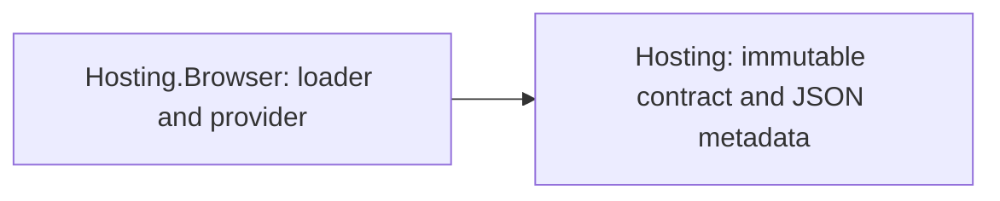

# Browser hosting design

## Registration

`ConfigureBrowser(Action<BrowserApplicationOptions>?)` finds the `BrowserApplicationOptions`
instance registered in `builder.Services`, or registers a new one, applies the callback, validates
the mount selector, and passes the stateless `BrowserViuApplicationHostFactory` to the
host-neutral `ConfigureHost(...)` seam. Repeated calls therefore configure one instance instead of
replacing earlier settings with defaults. When the last `BrowserApplicationOptions` registration
is a factory rather than an instance, a new instance is added so the configured values are the
ones the provider resolves.

The factory resolves the options from the built provider when it creates the runtime and copies
the hydration flag and mount selector, so mutating the instance after `Build()` cannot change the
built host.

The API is marked for the browser platform. Its server-TFM test intentionally exercises only
configuration and `Build()`, which are DOM-free; starting the returned runtime remains a browser
operation.

## Runtime creation

The factory constructs `BrowserApplicationBuilder` directly and copies all current Viu
`ApplicationOptions` members:

- root component and component factory;
- built Cohesion service provider;
- state and directive resolvers; and
- error, warning, and event observers.

It then applies the browser hydration flag and mount selector and builds `BrowserApplication`.
That public Viu surface performs the browser-specific component/directive wrapping and freezes the
runtime context. The integration does not access renderer internals.

## Lifetime

The host-neutral package appends the resulting `BrowserApplication` as its final hosted service.
Cohesion cancellation stops the browser application, and the browser application's `Stopping`
token calls back into `HostContext.Shutdown()`. Disposal unmounts the Viu runtime before releasing
the Cohesion provider and configuration.

The library contains no static web assets. Asset delivery remains the responsibility of
`Assimalign.Viu.Browser` and its Browser SDK integration.

## Client document startup

Explicit singleton factories create the provider and its private `IHostService`. Registration
captures path and timeout; service creation captures the warning handler at application build.
The ordinary host-service order awaits the request before starting the final Viu runtime service,
so components see either an immutable complete document or `Empty`, never a partly loaded map.
Cancellation, HTTP, IO and JSON failures warn without failing startup. The service never disposes
the caller-owned HTTP client. It loads once per single-use application lifetime.

The browser package depends on the host-neutral contract:

