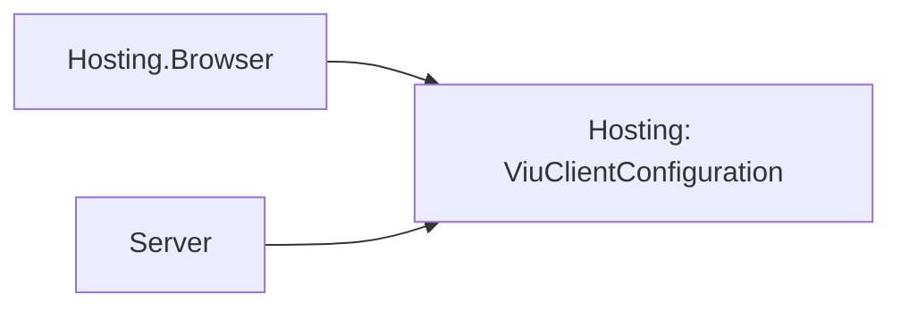

# Hosting design

## Boundary

The package owns application composition and Cohesion lifetime mechanics, but it does not choose a
renderer. `IViuApplicationHostFactory` is the only platform seam:

```csharp
IApplication CreateApplication(ApplicationOptions applicationOptions);
```

The factory receives a private snapshot and returns an explicitly constructed, single-use Viu
runtime. Browser and server packages remain separate from this host-neutral assembly.

## Build sequence

`ViuApplicationBuilder.Build()` performs one deterministic sequence:

1. Apply the standard-error warning and error handlers to unset diagnostics.
2. Register the shared configuration and environment instances.
3. `TryAdd` the `IComponentFactory` composition factory, capturing the options' component factory.
4. Build the Cohesion provider through `IServiceProviderBuilder`.
5. Snapshot every Viu `ApplicationOptions` member, assign the built provider to `Services` and the
   resolved `IComponentFactory` to `Components`, and resolve unset `State` and `Directives` from
   the provider.
6. Give a second options object to the configured host factory.
7. Resolve `IHostService` registrations.
8. Append the internal Viu runtime adapter as the final hosted service.
9. Create `ViuApplicationContext` and `ViuApplication`.

The retained snapshot and factory snapshot share registered component/state/directive references,
but they are different mutable `ApplicationOptions` objects. A platform builder cannot rewrite the
composition snapshot later exposed for a designed server-rendering host.

Default diagnostics are applied to the builder's own options, not only to the snapshot, because
host services such as the client-configuration loader read the builder's warning handler when the
provider first creates them.

## Component composition

Registration used to require one mutable `ComponentFactory` threaded through every registration
site. A later `ConfigureApplication` assignment silently discarded components that an extension
had registered into the earlier factory. Components are now service contributions:
`AddComponents(Action<ComponentFactory>)` and `AddComponent(ComponentRegistration)` each register
one internal `ViuComponentContribution` singleton, and the composition factory applies
`GetServices<ViuComponentContribution>()` in registration order on first `IComponentFactory`
resolution. `Build()` performs that resolution, so conflicts surface while building.

`AddComponents(Action<IServiceProvider, ComponentFactory>)` records the same contribution shape.
The original callback overload adapts to it by ignoring the provider. Composition passes the
container's root service resolver to each contribution; both forms run once in their shared
registration order and keep the same explicit-factory precedence. No temporary provider is built.
The callback cannot resolve the `IComponentFactory` currently being composed. The original
single-argument overload has higher overload-resolution priority so existing null-literal calls
retain their original null validation.

The composition keeps component resolution on the mount path to a single lookup:

- when the options still hold the builder-owned default factory, contributions are registered
  into it. A second layer would add a miss, including `ComponentFactory`'s camel- and
  Pascal-case name retries, to every mount.
- when the application assigned another factory, contributions are registered into a private
  factory that a layered resolver consults only after the assigned factory misses; with no
  contributions the assigned factory is used unchanged.

`ComponentFactory.Register` reports a duplicate reference as a plain `ArgumentException` naming the
key; composition rethrows it as `InvalidOperationException`. `AddComponent` skips a registration
instance that is already resolvable, so repeated contribution of one registration is idempotent.
The composition registration uses `TryAdd`, so an application `IComponentFactory` service replaces
it. Unset `State` and `Directives` resolve from `IStateStoreRegistry` and `IDirectiveResolver`
services; assigned options win.

## Lifecycle bridge

`ViuApplication` derives from `Host<ViuApplicationContext>`. The internal runtime adapter maps
Cohesion `StartAsync` and `StopAsync` to Viu's `ValueTask` lifecycle. It also registers the Viu
`IApplicationContext.Stopping` token with `HostContext.Shutdown()`.

The adapter is last in `HostedServices`, producing these orders:

```text
start: user service 1 -> user service 2 -> Viu runtime
stop:  Viu runtime -> user service 2 -> user service 1
```

`OnStartingAsync` claims a one-time execution flag before any hosted service starts. A failed or
cancelled first attempt remains consumed, matching Viu's application contract.

## Configuration

A default Cohesion `ConfigurationManager` has no provider and uses `ExistingOnly`, so assigning a
new path would otherwise do nothing. The Viu builder creates the manager with the `Distributed`
set strategy and adds a private writable provider. Direct builder assignments are therefore real,
while callers may still add explicit Cohesion providers.

## Ownership and failure behavior

The Viu runtime borrows its services, state, directives, and component registry. The outer Cohesion
application establishes the ownership boundary instead. Disposal first asks the base host to stop,
then disposes the runtime, provider, and configuration manager. Disposal is best-effort across all
three owned resources and aggregates multiple failures.

The package uses no runtime XML parsing or assembly scanning. Compiler-generated Viu catalog
publication supplies direct delegates without runtime metadata discovery.

## Service activation

Package registrations use explicit instances and factories. Generated component activators and
aggregate catalog delegates are compiler-known; no runtime assembly inspection or constructor
activation is added by this integration.

## Client configuration boundary

Hosting owns the immutable wire contract and source-generated JSON metadata, so browser and
server agree without either depending on the other. No resource runtime, mounts, settings,
credentials or trust keys are serialized by this type. Mutable caller dictionaries are copied
into read-only nested maps. Browser failure uses the shared `Empty` instance.

The dependency direction remains host-neutral:



Hosting packages still enumerate Cohesion's `ServiceProviderBuilder.Container` when they need to
find a registered options instance, as `ConfigureBrowser` and `AddRouting` do.

With no explicit factory or component contributions, `ViuApplicationBuilder` populates the
compile-time generated aggregate by default. `services.AddComponents()` explicitly requests that
aggregate and is idempotent per factory, including application and referenced Viu assemblies.
Explicit callbacks and `AddComponent` suppress the implicit aggregate; combine either with
`AddComponents()` when both are wanted. An options-assigned factory stays first, with explicit
contributions as fallback; a service-registered `IComponentFactory` replaces composition entirely.
`AddRouting` contributes built-in router components; call `AddComponents()` explicitly to
include the generated aggregate alongside routing or other feature contributions.

Component contributions also register a lazy `IComponentFactory` service for Web compositions.
A shared internal composition descriptor lets `ViuApplicationBuilder.Build` set the final options
factory after all callbacks, preserving ordering and replacement semantics. Generated population
runs only at first factory resolution. `UseRootComponent<TComponent>()` uses the static definition
contract and never activates a component.
