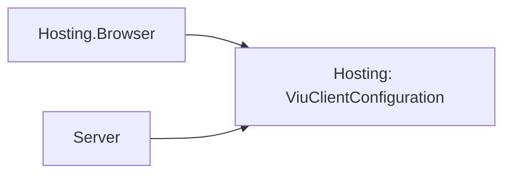

# Hosting design

## Boundary

The package owns application composition and Cohesion lifetime mechanics, but it does not choose a
renderer. `IViuApplicationHostFactory` is the only platform seam:

```csharp
IApplication CreateApplication(ApplicationOptions applicationOptions);
```

The factory receives a private snapshot and returns an explicitly constructed, single-use Viu
runtime. Browser and server packages remain separate from this host-neutral assembly.

## Build sequence

`ViuApplicationBuilder.Build()` performs one deterministic sequence:

1. Register the shared configuration and environment instances.
2. reject every service descriptor that requests `ImplementationType` activation;
3. build the Cohesion provider through `IServiceProviderBuilder`;
4. snapshot every Viu `ApplicationOptions` member and assign the built provider to `Services`;
5. give a second options object to the configured host factory;
6. resolve explicit `IHostService` registrations;
7. append the internal Viu runtime adapter as the final hosted service; and
8. create `ViuApplicationContext` and `ViuApplication`.

The retained snapshot and factory snapshot share registered component/state/directive references,
but they are different mutable `ApplicationOptions` objects. A platform builder cannot rewrite the
composition snapshot later exposed for a designed server-rendering host.

## Lifecycle bridge

`ViuApplication` derives from `Host<ViuApplicationContext>`. The internal runtime adapter maps
Cohesion `StartAsync` and `StopAsync` to Viu's `ValueTask` lifecycle. It also registers the Viu
`IApplicationContext.Stopping` token with `HostContext.Shutdown()`.

The adapter is last in `HostedServices`, producing these orders:

```text
start: user service 1 -> user service 2 -> Viu runtime
stop:  Viu runtime -> user service 2 -> user service 1
```

`OnStartingAsync` claims a one-time execution flag before any hosted service starts. A failed or
cancelled first attempt remains consumed, matching Viu's application contract.

## Configuration

A default Cohesion `ConfigurationManager` has no provider and uses `ExistingOnly`, so assigning a
new path would otherwise do nothing. The Viu builder creates the manager with the `Distributed`
set strategy and adds a private writable provider. Direct builder assignments are therefore real,
while callers may still add explicit Cohesion providers.

## Ownership and failure behavior

The Viu runtime borrows its services, state, directives, and component registry. The outer Cohesion
application establishes the ownership boundary instead. Disposal first asks the base host to stop,
then disposes the runtime, provider, and configuration manager. Disposal is best-effort across all
three owned resources and aggregates multiple failures.

No `InternalsVisibleTo`, runtime XML parsing, reflection activation, or assembly scanning is used.

## Client configuration boundary

Hosting owns the immutable wire contract and source-generated JSON metadata, so browser and
server agree without either depending on the other. No resource runtime, mounts, settings,
credentials or trust keys are serialized by this type. Mutable caller dictionaries are copied
into read-only nested maps. Browser failure uses the shared `Empty` instance.

The dependency direction remains host-neutral:



Service validation now enumerates Cohesion's `ServiceProviderBuilder.Container`; instance and
factory registration remain the only supported activation paths.
