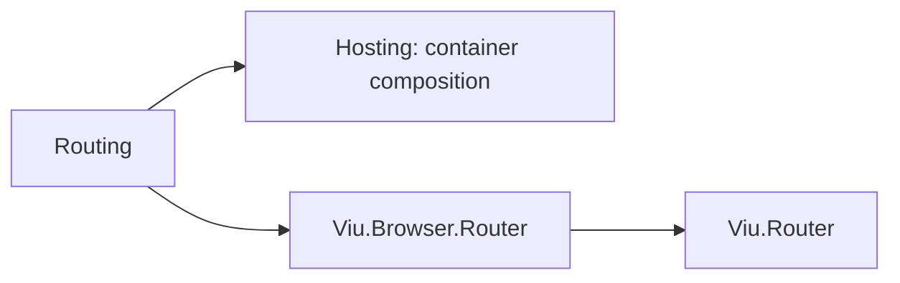

# Routing design

## Boundary

The package places routing registration in the Cohesion hosting layer instead of in Viu. Viu's
router consumes an application `IServiceProvider` (`RouterView` and `RouterLink` resolve the router
from `ComponentContext.Services`) and never prescribes how that provider is composed. Registration
verbs therefore live where the container lives. Viu's `IApplicationBuilder` stays limited to
`ConfigureApplication` and `Build` (`[APP-2]`), and hosting remains a Cohesion concern (Viu
decision D7).

`AddRouting` (build time) and `UseRouter` (after build) mirror Cohesion Web's
`AddRouting`/`UseRouting` split: registration contributes services and components, while the
application-lifetime middleware is installed explicitly because its order relative to other
middleware matters (`[APP-4]`).

## Registration

The first `AddRouting` call registers:

1. one `ViuRoutingOptions` instance, which later calls find by scanning the container and
   configure;
2. a `TryAdd` factory for `IRouterHistory`, so an application history registered before or after
   the call wins;
3. a singleton `Router` factory; and
4. a component contribution that registers `RouterView` and `RouterLink` under their type
   references and template names, keeping any registration already resolvable for either identity.

`AddRoutes` registers one internal `ViuRouteContribution` singleton per call. The router factory
concatenates `ViuRoutingOptions.Routes` with every contribution in registration order, constructs
the router over the resolved history, applies scroll behavior and link classes, and runs
`ConfigureRouter` callbacks in order. If configuration throws, the factory disposes the router
before rethrowing, because the provider never received it.

The default history is selected by `OperatingSystem.IsBrowser()`: browser web history in a
browser, memory history elsewhere. That keeps registration host-neutral and lets host-free tests
exercise the real router.

## Lifetime

`UseRouter()` resolves the router from `ViuApplication.Context.Services`, so an invalid route table
or failing callback surfaces before the application runs, and delegates to Viu's
`IApplication.UseRouter(Router)` middleware. Registration throws once execution has begun, like any
application middleware.

The provider disposes the router before the history it created. A history supplied as an existing
instance is not disposed by the provider.

## Server rendering

The router is a provider singleton. The Server package's convenience path shares the application
provider across concurrent requests, so a request-specific router needs a request-scoped provider
supplied through the advanced request-scope factory. Scoped routing registration is not part of
this package.
