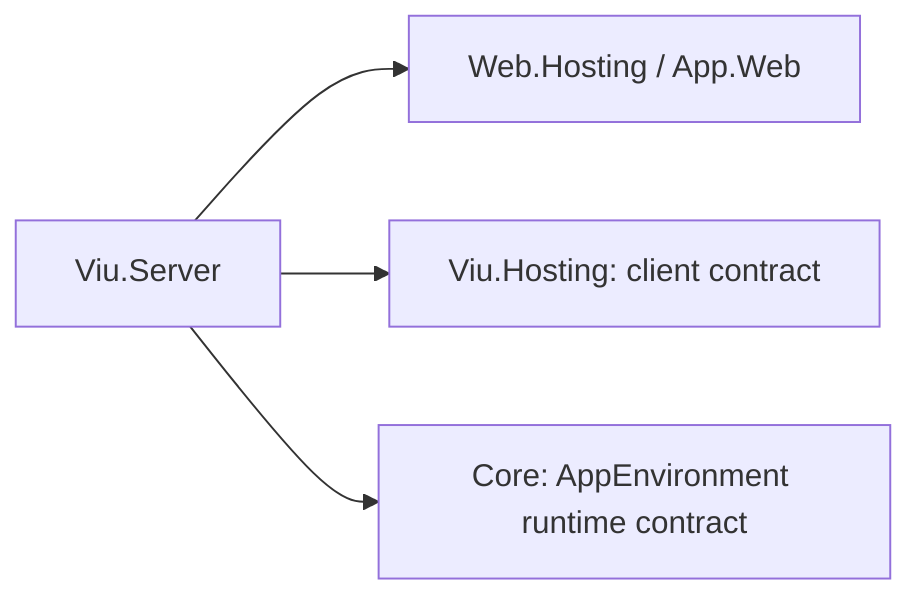

# Assimalign.Cohesion.Viu.Server design

## Hosting boundary

The Cohesion Web application builder is the bridge's guiding public surface. `AddViuApplication`
adapts `IWebApplicationBuilder` to `Services.AddViuClient` on the concrete Web builder;
custom implementations retain feature-based registration. Service registration captures immutable
asset configuration and creates a non-disposable `IHttpFeature` through an explicit factory. `UseViuApplication` installs that
configuration on the built application; the pipeline-only overload and both explicit server-render
verbs remain available for non-hosting pipeline implementations.

This external platform package intentionally composes `Web.Hosting`; Cohesion's hosting-isolation
rule constrains feature projects inside the Cohesion repository, while this Server package is the
cross-repository host bridge. It therefore consumes
`Assimalign.Cohesion.Sdk.Web` and its App/App.Web shared frameworks rather than direct Cohesion Web
library packages. `Assimalign.Cohesion.FileSystem.Globbing` is the one direct Cohesion package: it is
not an App or App.Web framework member, and the static-asset catalog matches globs with it. The Web container owns composition and lifecycle;
listener ownership and process lifetime remain with the Cohesion Web host.

The package's nuspec carries framework references for `Assimalign.Cohesion.App` and
`Assimalign.Cohesion.App.Web`; its ordinary dependencies are
`Assimalign.Cohesion.Viu.Hosting` `10.0.0-preview.1` and
`Assimalign.Viu.ServerRenderer` at the Viu pin in `global.json`. Cohesion's preview HTTP/Web API remains a preview
surface, so this assembly opts in while avoiding runtime-preview mechanisms of its own.

## Endpoint precedence

Cohesion routing selects an `IRouterEndpointFeature`, and the pipeline terminal executes it after
downstream middleware. The client middleware delegates a selected endpoint before changing response
headers or handling client configuration, refresh endpoints, static assets, or the SPA fallback.
This preserves endpoint policies and routing-generated responses such as 405, which need not carry
a matched-route feature. Hosts place `UseRouting()` before `UseViuApplication()`.

Only selected endpoints receive this precedence. Requests without an endpoint follow normal Viu
content resolution; the middleware does not infer an API namespace from a path prefix.

## Manifest model and asset resolution

Both supported manifest object graphs are closed internal types registered on
`StaticWebAssetsJsonContext`. Metadata generation is chosen because the input is read once at
middleware construction; no reflection fallback is allowed. A malformed supplied manifest fails
composition with an `InvalidOperationException` instead of producing a partially valid catalog.

The runtime trie is flattened into exact route mappings and pattern registrations. Endpoint
variants remain grouped by public route so each request can select content encoding. Resolution is:

1. normalize and reject traversal or platform-separator input;
2. select an endpoint variant using client and manifest qualities;
3. resolve the endpoint's `AssetFile` through runtime roots/patterns or the configured content root;
4. if no endpoint resolves, try the normalized path directly;
5. for an otherwise unhandled non-file GET or HEAD outside `/_framework`, resolve identity
   `index.html` when fallback is enabled.

Every root combination is canonicalized and checked before opening a file. The catalog is immutable
after construction, while the managed-delta cache is the only synchronized mutable feature state.
Asset bodies stream from disk. Conditional validation and byte ranges remain deferred: the
App.Web-delivered Cohesion StaticFiles implementation does not consume Viu's static-web-assets
endpoint graph, so direct delegation would lose fingerprint and content-encoding selection.
Refresh injection intentionally buffers only HTML, removes stale encoding/validator headers,
recalculates content length, and forces `no-store`.

## Browser-refresh compatibility

The dotnet-watch middleware's client script is an embedded private resource and is not available as
a supported package API. The bridge vendors a readable minimum implementation of the observable
contract instead:

- a 500 ms delayed connection and one-page sentinel;
- comma-separated endpoint fallback;
- optional 32-byte shared secret encrypted with an SPKI RSA-OAEP/SHA-256 public key and sent as the
  URI-encoded WebSocket subprotocol;
- page reload/wait behavior, stylesheet cache busting, managed-delta acknowledgement, and HTTP
  delta caching.

The clear-cache endpoint returns `Clear-Site-Data: "cache"`. The hot-reload endpoint is terminal
while enabled: GET/POST follow the cache contract and all other verbs return 405. The script and
endpoints do not exist when the WebSocket endpoint environment variable is empty.

The first pass omits Microsoft's later diagnostics/capability messages, boot-resource response
header injection, and the managed-update log returned by Blazor's internal hook.
`ApplyManagedCodeUpdates` uses that hook when present; in a
pure Viu runtime it preserves the delta in the cache but cannot execute it until Viu exposes a
browser managed-update hook. Static CSS updates and full reloads are functional independently.

The asset catalog captures both manifests at middleware construction. Existing physical files can
change in place during watch, but newly fingerprinted routes require a process restart. This matches
the current dev-server lifecycle; an atomic manifest-reload layer remains a future enhancement if
the host begins surviving route-graph changes.

## Server composition and request ownership

`services.AddViuServerRendering` registers one options instance, the component contribution seam,
and factory-created composition/lifecycle services in the Web container. Web build materializes
host services, so missing roots and invalid/conflicting catalogs fail before requests arrive.
The composition service snapshots all options, calls `RegisterGeneratedRenders()` only when
`ServerRenders` is unset, and freezes the selected registry. `Components` overrides the composed
`IComponentFactory`; otherwise `AddComponents()` supplies compile-time aggregate catalogs.
Neither registration path uses reflection activation or creates a second service provider.

The service owns a composition-only `ServerViuApplication` lifetime. Web start/stop delegates to
that runtime, and Web provider disposal releases it. No persistent renderer or mounted tree is
retained. The pipeline resolves this service once, then installs immutable middleware; request
execution does not resolve the composition service again.

Cohesion DI supports asynchronous child scopes, while `IHttpContext` exposes no request-services
provider. The new request factory therefore creates one render-owned async scope and copies the
frozen component and diagnostic references into new application options. It resolves unset state
and directives from the child provider, creates a fresh application context, render application,
and SSR context, and returns ownership of the DI scope to Viu's adaptor. Scope creation failures
release any already-created scope. Teardown always releases the scope even for a cancelled HTTP
request, after Viu's renderer has released its component leases. This permits scoped application
services without changing Cohesion's HTTP contracts or synthesizing ambient HTTP-context services.
Explicit state/directive instances remain shared and borrowed; request state should be factory
registered with a scoped lifetime. Singleton services remain the Web host's singletons.

The existing borrowed-application and explicit-adaptor overloads retain their ownership rules.
`AddViuServerApplication` starts/stops a caller-owned Viu host and never disposes it. Its request
factory still borrows that host's root provider without making child scopes. Applications needing
custom request roots, HTTP-aware services, or coordination with another middleware scope provide
an explicit `ServerRenderAdaptor<IHttpContext>` and request-scope factory.

`ViuServerRendererMiddleware` maps HTTP to Viu's public adaptor and output contracts. It preserves
prefix/main/teleport-suffix ordering, progressive flushes, cancellation, and host exception mapping.
Cohesion's current response body is replaceable memory; attempted writes/flushes do not establish
transport commitment. Encoder completion precedes replacement of a failed buffered response.
A future streaming transport must supply authoritative commitment state. Document shells can splice
teleports into the suffix only; earlier destinations require buffering or a prepass.

## AOT constraints

Shipping code is marked AOT compatible. Request dispatch is ordinary closed-type code; manifest
JSON uses generated metadata; the refresh delta validator uses `JsonDocument`; and no reflection,
dynamic code generation, runtime XML parsing, or assembly discovery is used. Public registrations
and the supplied root factory keep application activation explicit.

## Client publishing and client document

`buildTransitive/Assimalign.Cohesion.Viu.Server.props|targets` select normal
`ProjectReference` items marked `ViuClient="true"` at evaluation time. This preserves the restore
graph while automatically suppressing compile references and transitive content copying. NuGet
excludes package imports when evaluating restore, so Viu SDK framework identities from clients or component libraries can still
appear in the graph. Before .NET adds transitive framework references, the package removes only
`Assimalign.Viu.App` and `Assimalign.Viu.App.Browser` from that transitive list. Direct framework
references and unrelated frameworks remain intact; no second restore or path guessing is needed. The
reference removes Web RID, self-contained, AOT, trimming and ready-to-run properties.
`ViuResolveClientOutput` queries the Browser SDK's `GetViuBrowserClientInfo` contract, validates
one Browser identity and complete metadata, and uses the returned output/manifest paths directly.
Missing or ordinary non-Browser projects and multiple marked clients fail clearly. The retired
`ViuClientReference` and `ViuClientProject` inputs fail with the replacement XML in the error.
The target writes the identity, output and manifest paths into `<client>.viu-client.json` in the Web project's intermediate directory and
declares that file as copy-to-output content (`CopyToPublishDirectory=Never`), so it sits beside
the Web executable and, because content copies through project references, beside a gateway
executable that references the Web project to run it in its own process. A runtime configuration
option was the earlier carrier and was retired: `AppContext` data is process-wide, so a program a
gateway runs in its own process could never see its own value. `ViuPublishClient` restores and
publishes the browser in Release, then registers all published `wwwroot` files as
`ResolvedFileToPublish`, so SDK container payloads include them. It never packs or changes a
sibling project. Such a gateway references the Web project, so the Web project's client reference
carries `PrivateAssets="all"` (the template does) to keep the browser client out of the gateway's
references.

`UseClientOutput` first checks `AppContext.BaseDirectory/wwwroot/index.html`, then reads the client
document from the content root the platform names (`AppEnvironment.Variables.ContentRoot`, read
through `AppEnvironment` so a program a gateway runs in its own process reads its own scope; the
runtime contract reserves it and no current gateway sets it) and from `AppContext.BaseDirectory`.
The document is named for its client, so a gateway that references two Viu Web projects receives
both documents side by side: `UseClientOutput("<client>")` reads its own, and the parameterless
overload accepts a sole document and fails, naming the candidates, when there are several. Incomplete documents require
a rebuild instead of guessed paths. A published root uses no asset manifest; a build root uses both
runtime and endpoints manifests. Physical files retain their logical names for MIME lookup while
compression selects a sibling and adds `Vary`. The bare health probes `/healthz`, `/readyz` and
`/livez`, Web.Health's default paths, continue before file lookup, predicate execution, or SPA
fallback, so a probe placed after the Viu middleware is still reached. Every other path, including
anything under `/cohesion`, belongs to the browser application.

The client document's identity is captured during composition from the runtime contract the
instance's platform sets: `AppEnvironment.Variables.Application`, `.Resource` and `.Gateway` (the
platform name, such as `inprocess`). Its references are only the endpoints the application adds
with `ViuApplicationOptions.AddClientReference`, typically from a setting the gateway passes as
configuration. Explicit field projection prevents secrets, settings, mounts, bootstrap credentials
and trust material from entering JSON. For an unmanaged host, the concrete Web builder or built
application supplies its environment; other pipeline-only composition falls back to
`AppEnvironment`. These local concrete-type checks avoid adding state to `IWebApplicationBuilder`.
JSON metadata lives in Hosting and responses are never cached. Route validation rejects probe
routes and non-local request paths.

The package dependency direction is:

A Viu site becomes a managed resource the way every Cohesion Web application does: its program
calls `builder.Services.AddResource(name, resource => resource.UseInProcess())` from
`Web.Hosting.ApplicationModel`. Viu.Server adds nothing to that registration and references no
ApplicationModel package; the in-process gateway test (`InProcessGatewayTests`) runs a Viu site
under `InProcessInfrastructure` and reads its client document.

### Removed with Cohesion's application-model restart (2026-11)

Cohesion PR #1759 replaced the old application model. These behaviors existed only for it and were
removed, with their tests:

- **`ResourceContext`/`ResourceRuntime` (`Hosting.Resources`).** Identity now comes from
  `AppEnvironment`.
- **The per-resource content root.** The old in-process gateway staged each resource's client
  document in a content root of its own. `COHESION_CONTENT_ROOT` replaces it only on paper: the
  runtime contract reserves it and no gateway sets it, so the document is read from beside the
  executable, which under an in-process gateway is the gateway's directory. Per-client document
  names keep several sites from overwriting each other there; a gateway running more than one Viu
  site names each client with `UseClientOutput("<client>")`. An in-process gateway runs a Viu site
  from a build, not from a publish: publishing the gateway copies neither the build-only client
  document nor the `wwwroot` that only the Web project's own publish bundles.
- **Gateway-wired references.** The client document no longer lists every gateway-declared
  dependency endpoint; a gateway passes an address as a setting, and the application publishes
  it with `AddClientReference`.
- **`ViuApplicationOptions.ControlPlanePath`** and the `/cohesion/v1` reservation. A Web
  application no longer serves a control plane on its own listener; the platform carries the
  gateway's calls. `/cohesion/v1` is now an ordinary application route.
- **`web.viu.*` manifest properties** (`CohesionResourceProperty` items under
  `CohesionApplicationModel=enabled`). There is no build-generated resource manifest, and the
  `Viu.ApplicationModel` package that validated them was deleted.

## Catalog publication in a Cohesion-only executable

The Server package ships a small incremental generator under `analyzers/dotnet/cs`. It reads
Viu's public `ComponentCatalogAttribute` and `ServerRenderCatalogAttribute` from compiler-known
assembly symbols, sorts full assembly identities, and emits module initialization with direct
publication delegates. This bridges Web executables that do not use the Viu SDK; it neither parses
components nor creates a second component catalog. Viu retains population, diamond deduplication,
and duplicate-component diagnostics. Application-local `.viu` files still use Viu's compiler.
Executable compilations enable publication by default; `ViuAutoRegisterGeneratedCatalogs=false`
opts out, and libraries can opt in. This compiler-only project is not a ninth shipping package.
