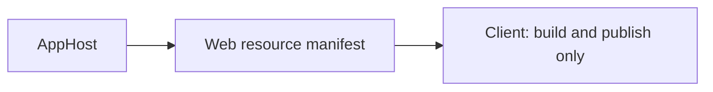

# Assimalign.Cohesion.Viu.Templates design

## Package shape

The project is a NuGet `Template` package with no build output or package dependencies. Files
under `content/viu-cohesion` are packed verbatim, allowing `dotnet new` to discover the template
from `.template.config/template.json`.

The template carries exact Viu SDK and Cohesion platform-package versions. MSBuild SDK versions must be
available before project restore can evaluate the generated project, so they are declared in its
`global.json`. The hosting and development-server versions are ordinary `PackageReference` values
consumed after restore.

## Host boundary

The generated application uses `ViuApplication.CreateBuilder()` as its composition root and
explicitly registers the browser runtime through `ConfigureBrowser()`. The
`Assimalign.Cohesion.Viu.DevServer` package separately owns development-host selection and command
line. This hosting model intentionally carries Cohesion dependency-injection, configuration, and
hosting assemblies into the WebAssembly application while keeping the development server out of
the runtime dependency closure.

## Package-feed contract

The generated `NuGet.config` maps Viu and Cohesion to the authenticated Assimalign GitHub Packages
feed and platform/gateway packages to local feeds.
`assimalignRoot` substitutes their common parent directory; nuget.org supplies public dependencies.
No credential is embedded. Remote publication is a separate release concern.

## AOT and trimming

The application enables full trimming for normal publishing. Ahead-of-time compilation remains an
explicit publish choice because it requires the WebAssembly tools workload and materially extends
build time. `AllowMissingPrunePackageData` keeps restore portable across .NET 10 SDK installations
that omit the optional pruning-data directory; it does not disable the trimmer. Runtime component
registration is generated at compile time; the template does not use reflection, assembly scanning,
or runtime source parsing.

## Three-project template

`viu-cohesion-web` keeps browser runtime code in Client, enabled Web hosting and client publishing
in Web, and orchestration in AppHost. The solution explicitly pins all five SDKs in its chain.
The `__COHESION_PACKAGE_VERSION__` template symbol defaults to the repository's tracked Cohesion CI identity;
`assimalignRoot` substitutes portable local-feed paths without hard-coding a developer machine.
AppHost defaults to the built-in Local gateway. Kubernetes is opt-in: set `CohesionGateways` to
`Local;Kubernetes` and `CohesionPlatformsVersion` to gateway packages built against the same
Cohesion pin. Older local preview.3 packages require a different Cohesion identity and cannot be
mixed with this CI pin.

Project references flow in this direction:

The generated client loads configuration before components start. Web uses its normal control
plane and `UseClientOutput`. AppHost composes the site with the explicit `AddViuWeb(Manifests.<Name>)`
verb (the template derives the member name from the project name); mapping the Viu overlay onto
the generated verb is a Cohesion SDK follow-up. The old `viu-cohesion` development-server template
stays available on the same family version.

The project files carry no runtime posture: the Cohesion SDK defaults `SelfContained`, the host
`RuntimeIdentifier`, and `DisableTransitiveFrameworkReferenceDownloads=true` for enabled resources,
so publishing the Web resource need not download unrelated Cohesion area runtime packs. Its HTTP
endpoint has development port 8080 so standalone `dotnet run` also binds a listener.
Ordinary ARM64 publication includes the client. The current Cohesion image resolver still accepts
only Linux x64 RIDs and requires NativeAOT for Release images; ARM64 OCI publication is an upstream
follow-up, not a change of the site's Web application model.

Both templates request generated aggregates through `AddComponents()`, choose typed roots with
`UseRootComponent<App>()` and add typed Counter routes through `routing.Routes.Add<Counter>`.
Web registers `services.AddViuClient()` and infers its sole marked client. Project references
participate in restore before build; Server metadata suppresses compile references. Explicit
`ViuClientReference` items are retired. Server rendering can be added with
`services.AddViuServerRendering` and the predicate-only `UseViuServerRenderer` overload.

After packing, run `pwsh scripts/tests/Test-Templates.ps1` for isolated template builds,
Web publication with a trimmed client, and a packed SSR consumer using a referenced Viu catalog.
The lane keeps its hive, cache and generated projects under `_out` and treats warnings as errors.
