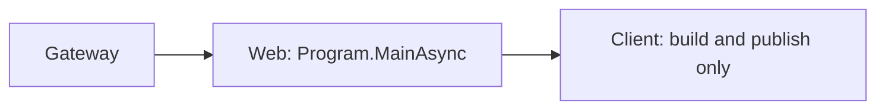

# Assimalign.Cohesion.Viu.Templates design

## Package shape

The project is a NuGet `Template` package with no build output or package dependencies. Files
under `content/viu-cohesion` and `content/viu-cohesion-web` are packed verbatim, allowing
`dotnet new` to discover each template from its `.template.config/template.json`.

The template carries exact Viu SDK and Cohesion platform-package versions. MSBuild SDK versions must be
available before project restore can evaluate the generated project, so they are declared in its
`global.json`. The hosting and development-server versions are ordinary `PackageReference` values
consumed after restore.

## Host boundary

The generated application uses `ViuApplication.CreateBuilder()` as its composition root and
explicitly registers the browser runtime through `ConfigureBrowser()`. The
`Assimalign.Cohesion.Viu.DevServer` package separately owns development-host selection and command
line. This hosting model intentionally carries Cohesion dependency-injection, configuration, and
hosting assemblies into the WebAssembly application while keeping the development server out of
the runtime dependency closure.

## Package-feed contract

The generated `NuGet.config` maps Viu and Cohesion to the authenticated Assimalign GitHub Packages
feed, and the `cohesion-platforms` platform packages (the Kubernetes and Docker pairs) to a local
feed. `assimalignRoot` substitutes their common parent directory; nuget.org supplies public
dependencies. No credential is embedded. Remote publication is a separate release concern.

## AOT and trimming

The application enables full trimming for normal publishing. Ahead-of-time compilation remains an
explicit publish choice because it requires the WebAssembly tools workload and materially extends
build time. `AllowMissingPrunePackageData` keeps restore portable across .NET 10 SDK installations
that omit the optional pruning-data directory; it does not disable the trimmer. Runtime component
registration is generated at compile time; the template does not use reflection, assembly scanning,
or runtime source parsing.

## Three-project template

`viu-cohesion-web` keeps browser runtime code in Client, Web hosting and client publishing in Web,
and the gateway in Gateway. The solution explicitly pins all five SDKs in its chain
(`Sdk`, `Sdk.Web`, `Sdk.Gateway`, `Viu.Sdk`, `Viu.Sdk.Browser`).
The `__COHESION_PACKAGE_VERSION__` template symbol defaults to the repository's tracked Cohesion
identity; `assimalignRoot` substitutes portable local-feed paths without hard-coding a developer
machine. The Cohesion packages each project adds (`ApplicationModel.Hosting.InProcess` in Web,
`ApplicationModel.Gateway.InProcess` in Gateway) take `$(CohesionVersion)`, which the pinned SDK
defines, so they cannot drift from the SDK.
In content the engine replaces the source name with its namespace-safe form (`my-site` gives
`my_site`), while file and folder renames keep the name as given. Project and solution paths
therefore use `__PROJECT_NAME__`, a symbol carrying the name unchanged, and each project sets
`RootNamespace` to the safe form so generated Viu components compile. `Test-Templates.ps1` builds a
`my-site` solution to keep both true.

Web is an ordinary Cohesion Web application. Its program calls
`builder.Services.AddResource("<name>-web", resource => resource.UseInProcess())`: started by a
gateway, the instance publishes itself through the platform its environment names; started on its
own, the call registers nothing. Its `Program` is an explicit public class so Gateway can call
`MainAsync`. Gateway follows the shape of Cohesion's `cohesion-app` template (`Acme.Gateway`) with
the program registered: `InProcessInfrastructure.AddProgram("Web", "<name>-web", Program.MainAsync)`,
`ApplicationGateway.CreateBuilder("<name>").UseInProcess(infrastructure)`, one `AddResource` per
resource, then `StartAsync`, which prints each resource's endpoint, and `Completion`. The gateway
stops on the process's shutdown signals; disposing the infrastructure stops the program.

Project references flow in this direction:

Gateway references Web to run its entry point, so Web's content, including
`<name>.Client.viu-client.json`, copies beside the gateway executable, where `UseClientOutput`
finds it. The gateway therefore runs the site from a build: its publish carries neither that
document nor Web's bundled `wwwroot`. Web's client reference
carries `PrivateAssets="all"` so the browser client never becomes a transitive reference of the
gateway.

The generated client loads configuration before components start. Web binds the `http` endpoint
the platform assigns (`COHESION_ENDPOINT_HTTP_SCHEME`, `_HOST` and `_PORT`), or Web.Hosting's development default
`127.0.0.1:5000` when run on its own. Ordinary publication, ARM64 included, bundles the client.

Both templates request generated aggregates through `AddComponents()`, choose typed roots with
`UseRootComponent<App>()` and add typed Counter routes through `routing.Routes.Add<Counter>`.
Web registers `services.AddViuClient()` and infers its sole marked client. Project references
participate in restore before build; Server metadata suppresses compile references. Explicit
`ViuClientReference` items are retired. Server rendering can be added with
`services.AddViuServerRendering` and the predicate-only `UseViuServerRenderer` overload.

After packing, run `pwsh scripts/tests/Test-Templates.ps1` for isolated template builds, a brief
run of the site's in-process gateway, Web publication with a trimmed client, and a packed SSR
consumer using a referenced Viu catalog. The lane keeps its hive, cache and generated projects
under `_out` and treats warnings as errors.
